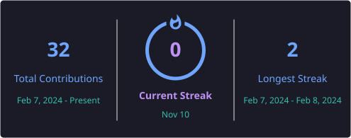

  

  
  
  
  

 

### 👨‍💻 Sobre Mim

Sou Desenvolvedor de Software e Engenheiro de IA (graduando em **Sistemas de Informação na Fametro**, 8º período), com experiência prática no **INDT (Instituto de Desenvolvimento Tecnológico)** atuando em validação técnica, automação e segurança da informação em ecossistemas móveis corporativos (ThinkShield).

Minha atuação é orientada ao desenvolvimento ponta a ponta (**Forward Deployed Engineering**), unindo:
1. **Engenharia de Software & Full Stack:** Criação de microsserviços de alto desempenho e APIs assíncronas com **Python (FastAPI)** e **Java (Spring Boot)**, com streaming bidirecional via **WebSockets** e renderização de vídeo em tempo real no **HTML5 Canvas**.
2. **Visão Computacional & Aceleração de Inferência:** Pipeline completo de captura de vídeo sem buffer bloat, detecção de objetos com **YOLOv8/v11**, rastreamento temporal com **ByteTrack** e compilação de modelos para GPU com **NVIDIA TensorRT** em precisão mista (**FP16**, atingindo **< 8 ms por frame**).
3. **Engenharia de Dados & IA Multimodal:** Modelagem relacional e vetorial com **PostgreSQL + pgvector (índice HNSW)**, filas em memória com **Redis Streams**, versionamento de dados com **DVC** e sistemas de **Visual RAG** com embeddings **OpenCLIP** e **Vision-Language Models (VLMs)**.

---

### 🚀 Entregas de Alto Impacto & Projetos em Destaque

<table>
  <tr>
    <td width="50%">
      <h3 align="center">🎯 EdgeVision-RealTime</h3>
      
<b>Pipeline de Visão Computacional em Tempo Real com Aceleração de Hardware</b>

      <ul>
        <li><b>Problema:</b> Monitoramento de zonas perigosas (ROI) e contagem de objetos sem atraso cumulativo de rede/buffer.</li>
        <li><b>Arquitetura:</b> Threaded video capture (anti-buffer bloat) + YOLOv11 TensorRT (FP16) + ByteTrack + FastAPI WebSockets + Canvas HTML5.</li>
        <li><b>Resultado:</b> Inferência contínua a <b>130+ FPS (< 8 ms/frame)</b> em GPU e streaming fluido a 30 FPS no navegador com Docker Compose.</li>
      </ul>
      

        <a href="https://github.com/icaromax/edgevision-realtime"><b>[Acessar Repositório]</b></a>
      

    </td>
    <td width="50%">
      <h3 align="center">🔍 OmniVision-RAG</h3>
      
<b>Auditoria e Busca Semântica em Vídeo com IA Multimodal e pgvector</b>

      <ul>
        <li><b>Problema:</b> Busca investigativa de eventos em centenas de horas de vídeo sem revisão manual assistida.</li>
        <li><b>Arquitetura:</b> Extração de keyframes + OpenCLIP (espaço latente 512d) + PostgreSQL 16 com índice HNSW (pgvector) + VLM (Qwen2-VL).</li>
        <li><b>Resultado:</b> Consultas em linguagem natural com resposta vetorial em <b>sub-milissegundos</b> e geração automática de relatórios técnicos em JSON.</li>
      </ul>
      

        <a href="https://github.com/icaromax/omnivision-rag"><b>[Acessar Repositório]</b></a>
      

    </td>
  </tr>
</table>

---

### 🛠️ Stack Tecnológica & Ferramentas

  <h4>Inteligência Artificial & Visão Computacional</h4>
  
  
  
  
  
  
  

    
  <h4>Backend & Full Stack</h4>
  
  
  
  
  
  
  

    
  <h4>Engenharia de Dados & Infraestrutura</h4>
  
  
  
  
  
  
  
  

---

### 📊 Estatísticas do GitHub & Atividade

<h3 align="center">📊 Estatísticas do GitHub & Atividade</h3>

  

  

 

  

### 🐍 Histórico de Contribuições

  <picture>
    <source
      media="(prefers-color-scheme: dark)"
      srcset="https://raw.githubusercontent.com/IcaroMax/IcaroMax/output/github-contribution-grid-snake-dark.svg"
    />
    <source
      media="(prefers-color-scheme: light)"
      srcset="https://raw.githubusercontent.com/IcaroMax/IcaroMax/output/github-contribution-grid-snake.svg"
    />
    
  </picture>

---

---

  Construído com base no Framework C.O.R.E. • Manaus, AM, Brasil

